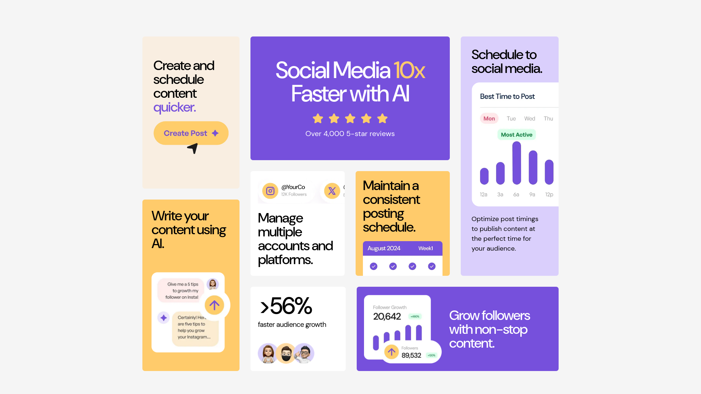
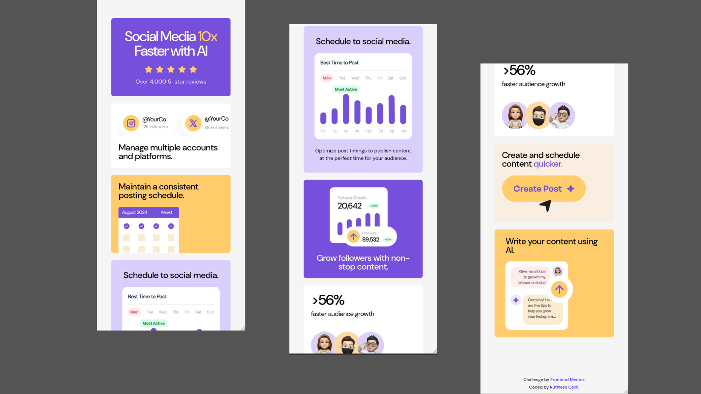

# Bento Grid

This is one of my Frontend Mentor challenge projects.

## Links

This is the challenge - [Bento Grid](https://www.frontendmentor.io/challenges/bento-grid-RMydElrlOj)

* Live Demo: [Bento Grid](https://ruthlesscalm.github.io/fm-bento-grid/)
* Solution: [Frontend Mentor Solution](https://www.frontendmentor.io/solutions/-pixel-perfect-fluid-bento-grid-and-398400-accessibility-VvP0mgxd0w)

## Preview

* **Desktop**

* **Mobile**

## Features

* Fully fluid and responsive layout (280px to 1920px)
* Accessibility-focused (semantic HTML, focus states, screen reader friendly)
* Built using CSS Grid and Flexbox

## Tech Stack

* HTML
* CSS

## Credits / References

* [Joshua Comeau](https://www.joshwcomeau.com/)

  * [Modern CSS Reset](https://www.joshwcomeau.com/css/custom-css-reset/)
* [Piccalilli - Andy Bell](https://piccalil.li/author/andy-bell/)

  * [Modern CSS Reset](https://piccalil.li/blog/a-more-modern-css-reset/)

## License

This project is licensed under the MIT License.

Feel free to use the code for learning, experimentation, or reference.
